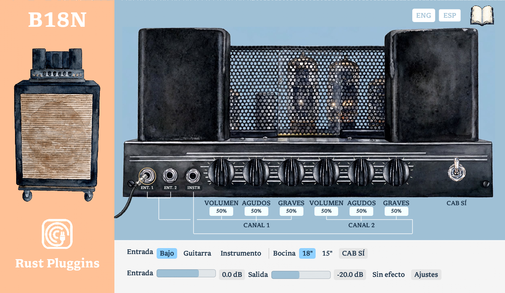

# B18N · V1.0

**Un amplificador de bajo de 1967, recreado en Rust.**

B18N es un efecto **VST3** de **Rust Pluggins**, basado en el circuito del
**Ampeg B-18N/B-15ND de 1967**. Combina una simulación por etapas del amplificador
con una interfaz ilustrada, controles animados y un manual integrado en español e inglés.

El VST está desarrollado **enteramente en Rust**: el motor de audio, la configuración
del modelo y la interfaz gráfica. Las herramientas externas de análisis se utilizan
durante el desarrollo y no son necesarias para utilizar el plugin.



[Ver interfaz en inglés](assets/ui/screenshots/b18n-eng.png)

## Basado en esquemas reales

Para desarrollar el modelo se han utilizado **esquemas eléctricos reales del Ampeg
B-18N de 1967**, concretamente el esquema **B-18N/B-15ND, revisión de mayo de 1967
(5/67)**, junto con el manual de servicio y documentación de las válvulas.

Estas referencias sirven para identificar las conexiones, los componentes y las etapas
del circuito. El modelo incluye los previos, las redes de volumen y tono, el inversor de
fase y la etapa de potencia. Los valores históricos se mantienen separados de los
parámetros de calibración y de las aproximaciones necesarias para la simulación digital.

- [Esquema B-18N/B-15ND, revisión 5/67](https://vintage-blue.com/assets/b18n-b15nd_schematic_5_67.pdf).
- [Manual de servicio B-18N de 1967](https://vintage-blue.com/assets/b18n_1967_service_manual.pdf).
- [Trazabilidad del circuito](docs/CIRCUIT_TRACEABILITY.md).
- [Procedencia de las referencias históricas](assets/reference/README.md).

Los PDF históricos se consultan localmente y no se redistribuyen en este repositorio.
El uso de esquemas reales no implica que cada comportamiento del hardware haya sido
medido: los datos estimados y de hojas técnicas se identifican como tales en la calibración.

## Funciones de la V1.0

- **Tres entradas seleccionables:** Input 1/Bass y Input 2/Guitar utilizan el canal 1;
  INSTR/Instrument utiliza el canal 2. El cable ilustrado señala la entrada activa.
- **Dos canales de controles:** volumen, agudos y graves independientes, con ambos
  previos procesando continuamente.
- **Perillas animadas y porcentajes editables:** arrastra para ajustar, usa Shift para
  mayor precisión o escribe directamente el porcentaje. Enter confirma y Escape cancela.
- **Bocinas de 18 y 15 pulgadas:** dos perfiles acústicos aproximados. CAB permite
  activarlos o escuchar la salida directa del amplificador. No son IR medidas.
- **Ajustes de nivel de entrada y salida**, bypass y calidad seleccionable 1×/2×/4×.
- **Interfaz ENG/ESP:** etiquetas, ayudas, ajustes y manual cambian con el idioma elegido.
  La selección se conserva con la instancia del plugin.
- **Procesamiento mono y estéreo**, automatización de parámetros y recuperación de estado.

La interfaz utiliza la tipografía [Libron v0.31 de Nico Verbruggen](https://github.com/nicoverbruggen/libron/releases/tag/v0.31),
integrada en Regular y Bold bajo [SIL Open Font License 1.1](assets/ui/Libron-LICENSE.txt).
[Detalles del editor](docs/UI_EDITOR.md) · [Procedencia de imágenes y recursos](assets/ui/README.md).

## Simulación, comparación y pruebas

El desarrollo utiliza referencias independientes para comparar el comportamiento del
motor Rust con simulaciones eléctricas y cálculos numéricos:

| Herramienta | Uso en el proyecto |
|---|---|
| **ngspice / SPICE** | Simular circuitos de referencia y obtener puntos de trabajo DC, respuestas AC y transitorios. |
| **Python y NumPy** | Preparar referencias, realizar cálculos independientes y comparar respuestas y datos de prueba. |
| **SciPy** | Ajustar modelos de válvulas a datos y curvas documentadas mediante optimización numérica. |
| **b18n-render, escrito en Rust** | Procesar WAV sin un DAW, realizar mediciones y generar reportes reproducibles. |
| **Cargo, rustfmt y Clippy** | Ejecutar pruebas automatizadas y comprobar formato y calidad del código. |

Los netlists, las condiciones de simulación y los resultados de referencia se conservan
para poder repetir las comparaciones. Estas comprobaciones respaldan las partes evaluadas;
no sustituyen una comparación auditiva o mediciones completas de un amplificador físico.

[Referencias y simulaciones SPICE](scripts/spice/README.md) ·
[Guía de implementación](docs/IMPLEMENTATION_GUIDE.md).

## Compilar el VST3

Se necesita el entorno Rust indicado en `rust-toolchain.toml` y las herramientas de
compilación de la plataforma. Para generar el bundle:

```bash
cargo xtask bundle b18n-plugin --release
```

En Windows, el resultado se encuentra en:

```text
target/bundled/B18N 67.vst3
```

Instala la carpeta completa del bundle en el directorio VST3 utilizado por tu DAW
y vuelve a explorar los plugins. Las capturas del README se generan a partir del editor;
la validación de apertura, escalado y comportamiento en cada DAW sigue siendo una
comprobación independiente.

## Verificación del código

```bash
cargo fmt --all -- --check
cargo clippy --workspace --all-targets -- -D warnings
cargo test --workspace
```

El renderizador offline se ejecuta con `cargo run -p b18n-render --release -- --help`.
Las herramientas Python y ngspice son opcionales para el usuario final y se requieren
únicamente al reproducir los análisis que dependen de ellas.

## Organización

```text
crates/b18n-dsp      Motor de audio Rust independiente del host
crates/b18n-config   Datos del circuito y configuración tipada
crates/b18n-plugin   Adaptador VST3, parámetros, estado e interfaz
crates/b18n-render   Renderizador y mediciones WAV offline
assets/models       Modelo histórico y calibración
assets/fixtures     Datos y señales de referencia
assets/ui           Ilustraciones, tipografías y capturas
scripts             Herramientas de análisis y simulación
docs                Arquitectura, trazabilidad y validación
```

## Licencia y atribución

Código bajo **GPL-3.0-only**. La distribución de binarios construidos con NIH-plug y
sus bindings VST3 debe respetar los términos de sus licencias. Las tipografías mantienen
su licencia y atribución propias.

**Proyecto independiente, no oficial.** No está afiliado ni respaldado por Ampeg o
Yamaha. Los nombres Ampeg, Portaflex y B-18N se utilizan para identificar el equipo
histórico que sirve de referencia.
